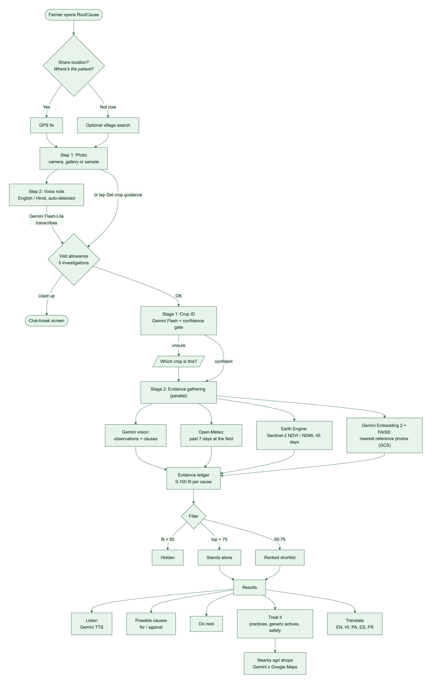
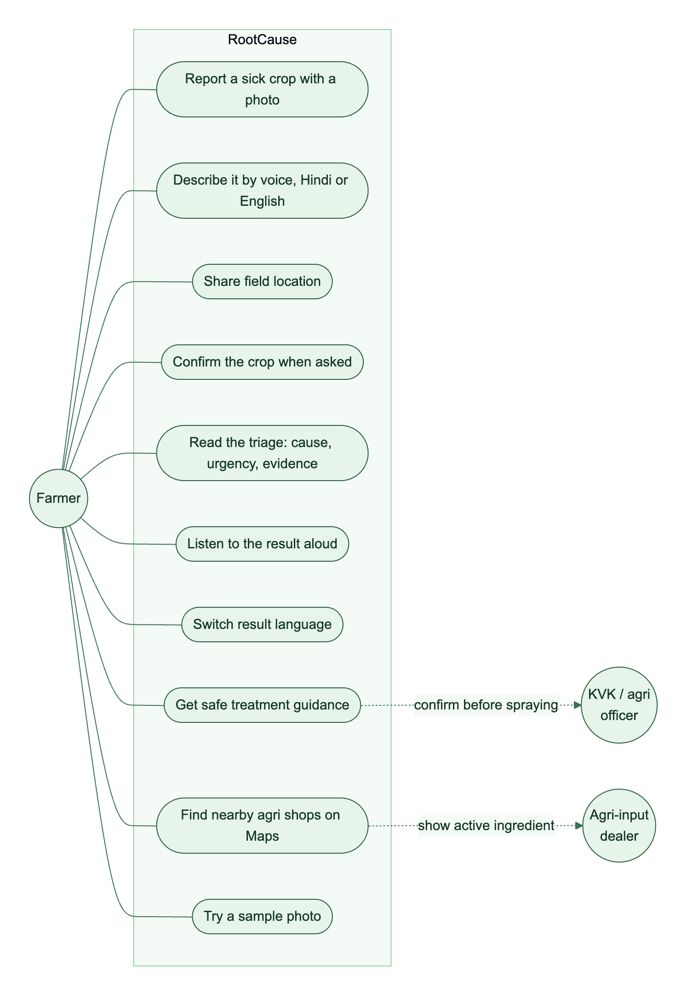
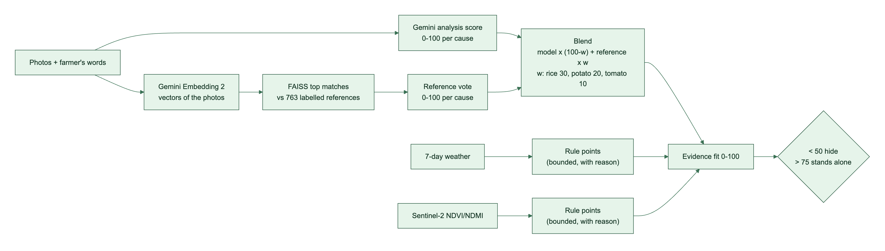
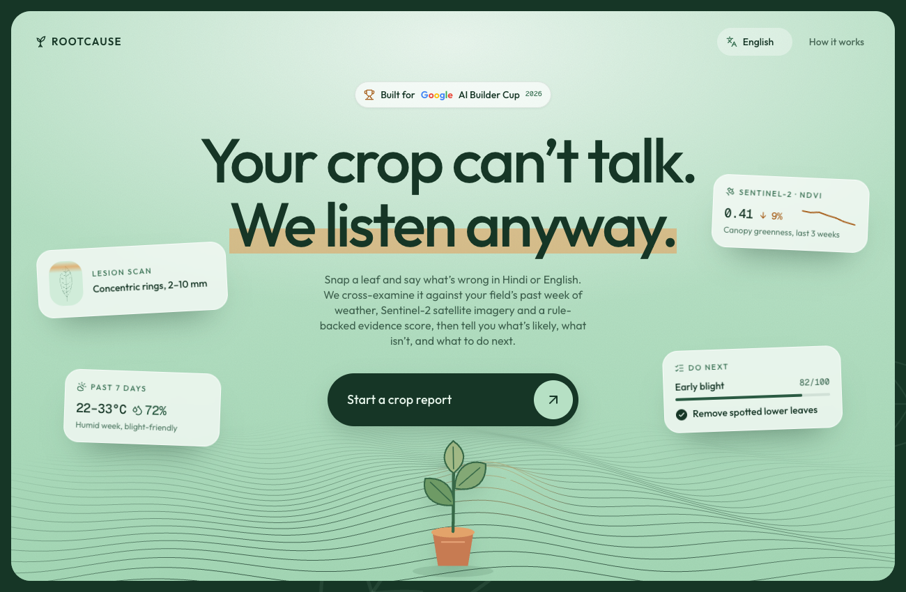
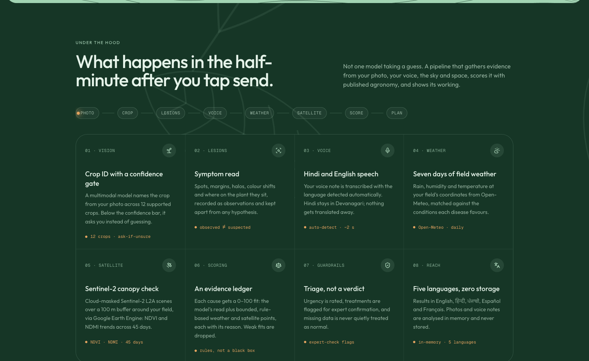
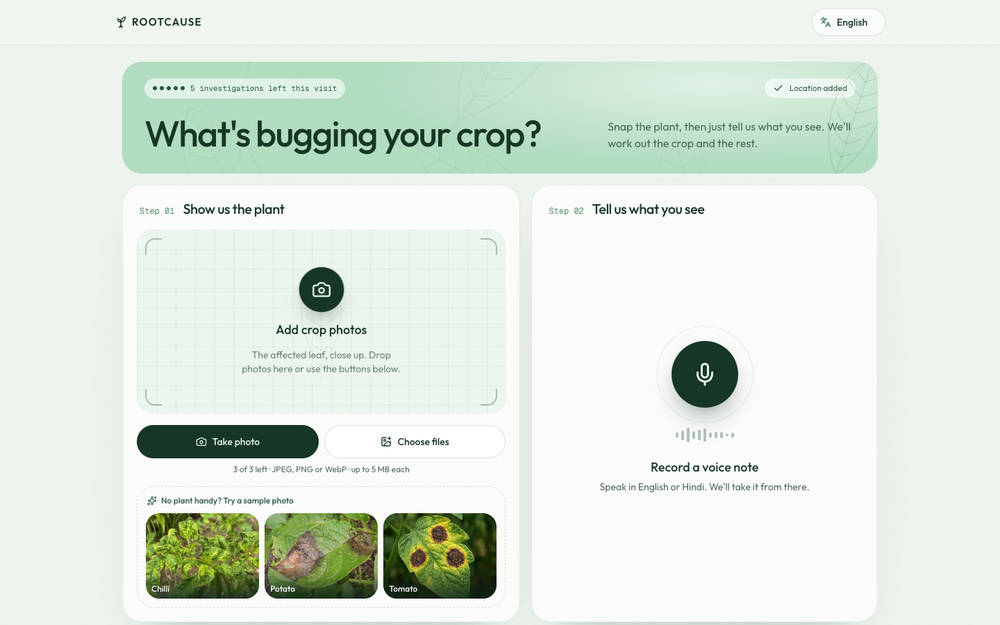
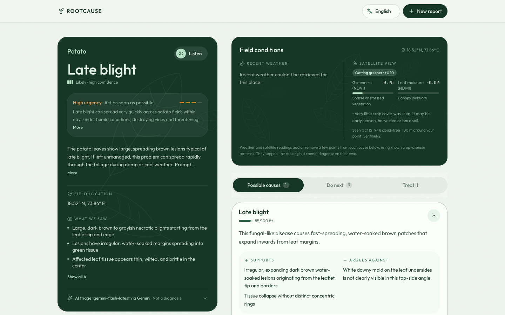
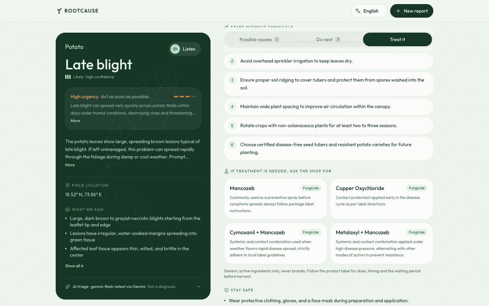
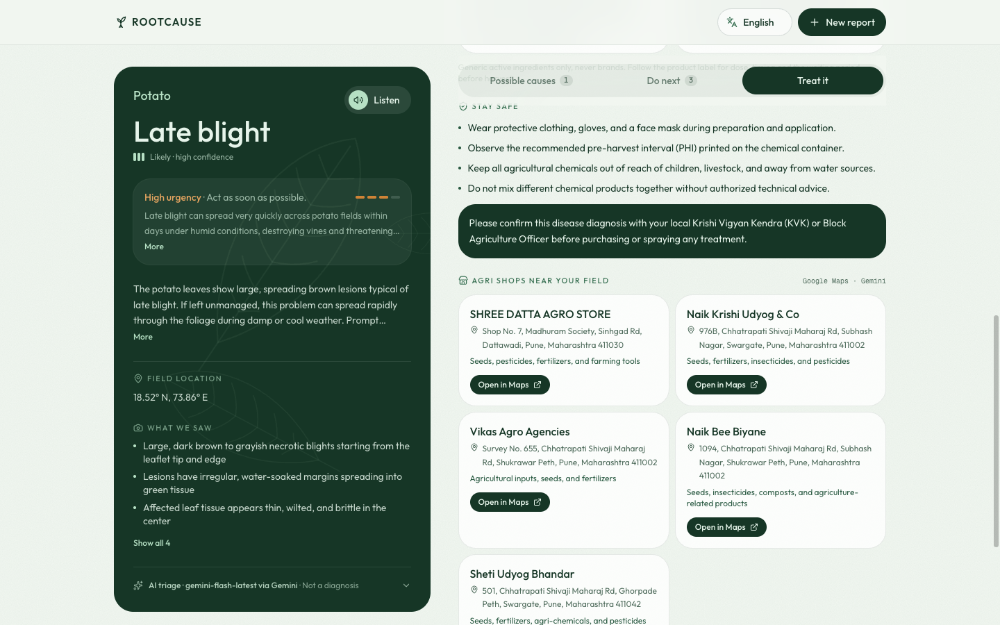
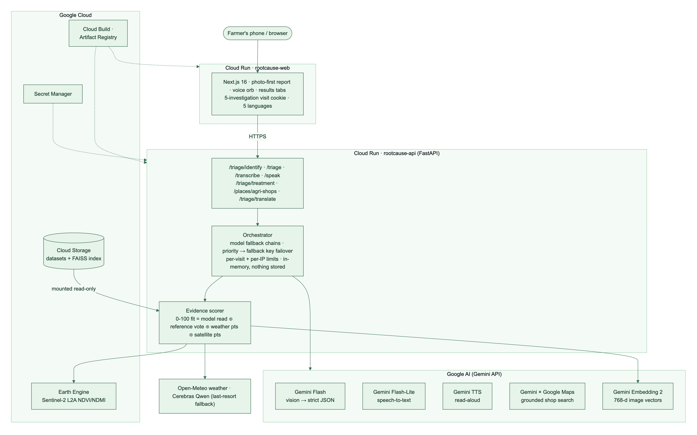

# RootCause · Google Cloud AI Builder Cup 2026

**Theme:** Sustainability & Social Impact · **Category:** Sustainability (food security)
**Tagline:** *Your crop can't talk. We listen anyway.*

> Every claim below is something a judge can click, hear or see in the deployed app, or read in
> this repository. Numbers come from our own runs; where a number is an estimate, it says so.

---

## 1. Problem statement

A leaf with brown spots is a mystery novel with the last chapter torn out.

- The FAO estimates that **up to 40% of global crop production is lost to plant pests and
  diseases every year**. In India, the person absorbing that loss is usually a smallholder with
  two hectares, a phone and no agronomist.
- Extension workers are spread thin across millions of farms, so the nearest expert is often a
  bus ride and several days away. Blight is not that patient: late blight can take a potato field
  within days of cool, wet weather.
- So farmers ask the person who sells the spray. The diagnosis arrives bundled with the product.
  Wrong chemical, wrong dose, more resistance, less money, same sick plant.
- Existing "plant doctor" apps answer one question (*what disease is this?*) from one input (a
  photo). They ignore the two facts that matter most to a plant pathologist: **what the weather
  has been doing** and **what the field looks like from above**. And they speak English to people
  who think in Hindi.

**The problem:** a farmer needs a fast, honest, local-language second opinion that uses all the
evidence, says how sure it is, and tells them what to do next, safely.

## 2. Brief about the idea

**RootCause is an AI field investigator, not a classifier.** The farmer snaps a leaf and *says*
what's wrong, in Hindi or English. Thirty seconds later they get a triage that reads like a good
agronomist's notes: what we saw, what it might be, how sure we are and why, how urgent it is, and
what to do now. Then it reads that out loud.

Under the hood, one photo kicks off an orchestrated investigation across five Gemini capabilities
and two Google Cloud data planes:

- **Gemini Flash** examines the photo and the farmer's words into structured, schema-validated
  observations and hypotheses (observed ≠ suspected, always kept apart).
- **Gemini Embedding 2** turns the photo into a 768-dimension vector and finds the nearest labelled
  cases among our curated reference library in **Cloud Storage** (FAISS index).
- **Google Earth Engine** pulls 45 days of cloud-masked **Sentinel-2** imagery over the field and
  reads the canopy's vital signs (NDVI, NDMI).
- **Open-Meteo** supplies the last 7 days of weather at the field's coordinates.
- An **evidence ledger** fuses all of it into a 0–100 fit per cause, with every point explained.
- **Gemini TTS** reads the result aloud; **Gemini grounded on Google Maps** finds the nearest
  agri-input shops; **Gemini Flash-Lite** transcribes the voice note with the language
  auto-detected.

It is triage, never a verdict, by design: low-evidence causes are hidden, chemicals are never
recommended by brand, and "confirm with your KVK first" is built into the flow.

## 3. How is it different? How does it solve the problem? USP

| | Typical plant-disease app | **RootCause** |
| --- | --- | --- |
| Inputs | One photo | Photo **+ voice + 7-day weather + 45-day satellite + reference library** |
| Output | A label and a % | Observations, ranked hypotheses with **evidence for and against**, urgency, missing info, next steps |
| Confidence | Softmax theatre | **Evidence ledger**: model read + reference vote + rule-based weather and satellite points, each with its reason; < 50 hidden, > 75 stands alone |
| Language | English, typed | **Hindi or English, spoken** (auto-detected), results in 5 languages, **read aloud** |
| Crop | "Select your crop" | Identified from the photo; asks only when unsure |
| Treatment | Brand-name spray (often sponsored) | Non-chemical steps first, **generic active ingredients only**, safety, KVK check |
| After the answer | Dead end | **Nearby agri shops on Google Maps**, one tap to directions |
| Honesty | Rarely says "I don't know" | Explicitly lists what it could not check; missing data is never treated as normal |

**How it solves the problem**

1. **Speed with humility:** a second opinion in about 30 seconds, without pretending to be the
   final word. Faster than the bus, more careful than the shop counter.
2. **Context beats pixels:** many diseases look alike on a leaf. Early and late blight are
   cousins; the weather tells them apart. RootCause scores the photo *against the conditions each
   disease needs*, and against how the canopy has changed from space.
3. **Accessible by default:** photo-first and voice-first, so literacy and typing are optional.
   The answer is spoken back in the farmer's language.
4. **Safer treatment:** it breaks the "diagnosis bundled with a product" loop by naming the
   *active ingredient* to ask for, not a brand, and by sending the farmer to a licensed shop and
   their KVK.

**USP, in one line:** *the only crop triage that cross-examines a farmer's photo and voice against
the sky, space and a labelled reference library, then explains every point of its confidence out
loud, in Hindi.*

## 4. Features

**Report: photo first, no typing**
- Camera, gallery or one-tap **sample photos** (chilli, potato, tomato) for judges.
- Crop identified from the photo, with a confidence gate ("Which crop is this?" only when unsure).
- **Voice note**, English or Hindi auto-detected; the transcript starts the analysis by itself.
- Explain-first location prompt (*"Where's the patient?"*); optional village search instead.
- Live analysis screen that names each real step as it runs (lesions, weather, Sentinel-2,
  patterns, scoring, plan).

**Investigation engine**
- Two-stage triage (identify, then diagnose) with strict JSON schemas validated by Pydantic.
- **Reference retrieval:** Gemini Embedding 2 vectors of the farmer's photo vs 763 curated, labelled
  references (17 crop-condition classes) in a FAISS index stored on Cloud Storage.
- **Sentinel-2** NDVI/NDMI via Earth Engine (SCL cloud mask, 100 m buffer, 45 days).
- **7-day weather** correlation with bounded, disease-specific rule points.
- **Evidence ledger:** blended 0–100 fit; weak causes (< 50) hidden; a confident one (> 75) alone.
- Guardrails: urgency rating, expert-check flags on treatments, missing data shown as missing.

**Results**
- **Listen:** Gemini TTS reads the main points in the result's language (prefetched: plays in
  ~0.3 s; the browser's voice is the fallback).
- **Possible causes** with supporting and contradicting evidence and the score breakdown.
- **Do next:** prioritised, safe actions.
- **Treat it:** non-chemical steps, generic active ingredients with label cautions, safety, KVK
  note; "Confirm first" banner unless the top cause scores above 75.
- **Nearby agri shops:** Gemini grounded on Google Maps, real places only, "Open in Maps".
- On-demand translation: English, हिन्दी, ਪੰਜਾਬੀ, Español, Français.

**Platform**
- Resilient orchestration: per-model fallback chains, **priority → fallback Gemini key failover**,
  Cerebras as last resort, labelled mock when offline.
- Fair use: **5 investigations per browser session** (enforced server-side) with a friendly
  "chai break" screen; per-IP hourly caps on every model-backed endpoint; failed calls refunded.
- Privacy: photos, audio and text processed in memory, never stored or logged.
- Two Cloud Run services built by Cloud Build; secrets in Secret Manager.

## 5. Process flow and use cases

How a cause earns its score:

Sources: [process-flow.mmd](diagrams/process-flow.mmd) · [use-case.mmd](diagrams/use-case.mmd) ·
[scoring.mmd](diagrams/scoring.mmd) (Mermaid; also exported as SVG).

## 6. Wireframes (real screens from the running prototype)

We skipped mock-ups: these are screenshots of the working app.

| | |
| --- | --- |
|  Landing: the pitch and the evidence cards |  "Under the hood": the pipeline, stage by stage |
|  Report: viewfinder, voice orb, sample photos |  Result: cause, urgency, evidence fit, **Listen** |
|  Treat it: practices first, generic actives |  Nearby agri shops via Gemini × Google Maps |

Phone: [location prompt](screens/04-location-prompt-mobile.png) ·
[live analysis](screens/05-analysing-mobile.png) · [visit limit](screens/09-visit-limit-mobile.png)

## 7. Architecture

- **rootcause-web** (Cloud Run): Next.js 16, App Router, React 19, Tailwind v4. Photo-first report,
  voice recorder (WebM/Opus or WAV), results tabs, visit cookie.
- **rootcause-api** (Cloud Run): FastAPI on Python 3.12. Stateless; every request is an
  orchestrated pipeline of model calls with fallbacks, limits and strict output validation.
- **Data plane:** reference datasets and the FAISS index on **Cloud Storage**, mounted read-only
  into Cloud Run; satellite from **Earth Engine**; weather from Open-Meteo.
- **Secrets** in Secret Manager; **builds** via Cloud Build into Artifact Registry.

Source: [architecture.mmd](diagrams/architecture.mmd).

## 8. Technologies

**Google AI (Gemini API)**

| Model | Job | Why it matters |
| --- | --- | --- |
| `gemini-flash-latest` | Crop ID, multimodal triage, translation, treatment guidance | Native image understanding with strict JSON schemas, so output is machine-checkable, not vibes |
| `gemini-flash-lite-latest` | Speech-to-text with language auto-detection; shop search | ~2 s Hindi/English transcripts, Devanagari preserved |
| `gemini-3.8-flash-lite-tts` → `gemini-3.8-flash-tts` | Read-aloud | Farmers who don't read still get the answer |
| `gemini-embedding-2` | 768-d image embeddings for reference retrieval | One multimodal embedding space for the library and the farmer's photo |
| Gemini **grounding with Google Maps** | Nearby agri-input shops and KVKs | Real places with Maps links, from the same Gemini key |

**Google Cloud**

| Service | Use |
| --- | --- |
| **Cloud Run** (gen2) | Both services; scale to zero; Cloud Storage volume mount for the index |
| **Cloud Storage** | Curated reference datasets and versioned FAISS indexes (write-once versions) |
| **Earth Engine** | Sentinel-2 L2A surface reflectance, SCL cloud masking, NDVI/NDMI time series |
| **Secret Manager** | Priority and fallback Gemini keys, Cerebras key |
| **Cloud Build + Artifact Registry** | Reproducible container builds and deploys |
| Cloud Speech-to-Text V2 (Chirp 3) | Optional voice fallback |

**Everything else:** FastAPI, Pydantic v2, httpx, FAISS, Next.js 16, React 19, Tailwind v4,
motion, react-hook-form + zod, Open-Meteo, Cerebras (Qwen) as a non-Google last resort,
pytest, ruff, mypy, Vitest, GitHub Actions CI.

**Orchestration, concretely:** each investigation fans out (vision, embeddings, weather,
satellite), fans in to the scorer, and degrades gracefully: model A → model B on a 429, key 1 →
key 2 on failure, Gemini → Cerebras as a last resort, and any missing signal is shown as "not
checked" rather than silently assumed. Every model reply is schema-validated; malformed output is
retried or rejected, never displayed.

## 9. Estimated implementation cost

| Item | Cost | Notes |
| --- | --- | --- |
| Gemini API prepaid credit | **$5** | Covers development testing, the demo and the judging window at Flash / Flash-Lite pricing (estimate) |
| Cloud Run (2 services) | ~$0 | Scale-to-zero; demo traffic sits inside the monthly free tier |
| Cloud Storage | < $0.10 / month | Reference library and index are well under 1 GB |
| Earth Engine | $0 | Non-commercial / research use |
| Open-Meteo | $0 | Free for non-commercial use |
| Cloud Build, Artifact Registry, Secret Manager | ~$0 | Within free allowances at our volume |
| Development | 2 builders × 4 days | Oct 14–17, 2026: 26 commits, ~22k lines of TypeScript and Python |
| **Total cash spend for the prototype** | **≈ $5** | |

**Per investigation (estimate):** about 5–7 model calls (crop ID, triage, embedding, optional
transcription, TTS, treatment, shop search). At Flash-Lite and Flash prices that is a fraction of
a US cent, so $5 funds on the order of a thousand full investigations. The 5-per-visit limit keeps
the demo inside that budget.

**At scale:** cost grows linearly with investigations and has no fixed GPU bill: Cloud Run scales
to zero, the index is a few MB of vectors, and the heavy lifting is pay-per-call Gemini.

## 10. Prototype performance and benchmarking

**Reference retrieval (held-out evaluation, our data)**

Curated from 7,418 raw images (Mendeley Rice v2, PlantDoc, PlantVillage; CC BY / CC BY-SA) into
**763 reference images + 333 held-out evaluation images** across rice (4 classes), potato (3) and
tomato (10). Recall@5 = at least one same-label reference in the top five.

| Crop | Field photos: Recall@5 / top-1 (n) | Lab photos: Recall@5 / top-1 (n) |
| --- | --- | --- |
| Rice | 0.986 / 0.861 (72) | — |
| Potato | 0.972 / 0.750 (36) | 1.000 / 0.909 (22) |
| Tomato | 0.781 / 0.406 (128) | 0.253 / 0.200 (75) |

*Measured on index v1 (DINOv2 baseline). The production index v2 uses Gemini Embedding 2 over the
same split; its evaluation run is `scripts/evaluate_retrieval.py --embedder gemini --index-version v2`.*

**Hybrid scoring:** blending the reference vote into the evidence fit raised the rice top-cause
hit rate from **0.50 to 0.90** on 10 held-out field photos (weights: rice 30%, potato 20%,
tomato 10%; potato and tomato weights kept where no gain was measured).

**Latency (measured on the prototype, single requests)**

| Step | Time |
| --- | --- |
| Gemini Embedding 2, one photo (768-d) | 1.2 s |
| Voice note transcription (Flash-Lite, auto language) | ~2 s |
| Nearby-shop search (Gemini × Maps) | 3.4–3.7 s |
| Treatment guidance | ~10 s, loaded when the tab opens |
| Read-aloud generation / playback after prefetch | 3–10 s / **0.3 s** |
| Full investigation (identify + triage + weather + satellite) | ~25–30 s |
| FAISS search | < 1 ms |

**Quality gates:** 125 API tests and 40 web tests, ruff, strict mypy and ESLint, run in CI on
every push. Every model response is validated against a strict JSON schema before it is shown.

## 11. Future development

- **Ask-back agronomist:** when two causes are close (late vs early blight), Gemini asks one
  targeted question by voice ("white fuzz under the leaf in the morning?") and re-scores.
- **Risk forecast:** use the 5-day forecast to warn before the weather turns blight-friendly.
- **Community early warning:** opt-in, anonymised, district-level outbreak map ("4 late-blight
  reports within 15 km this week") on Firestore + BigQuery.
- **More crops and regions:** extend the reference library (Paddy Doctor and more), Gemma on-device
  for offline first-pass triage in low-connectivity villages.
- **WhatsApp and IVR channels:** the same pipeline behind a photo + voice-note chat.
- **KVK hand-off:** a shareable case card for the extension officer, closing the expert loop.
- **Licensed marketplace partner** behind the "ask the shop for" card, kept strictly separate
  from the diagnosis so the answer never depends on what sells.

---

Built for the Google Cloud AI Builder Cup 2026. Triage guidance, not a confirmed diagnosis:
always check with a local agricultural expert before treating crops.
